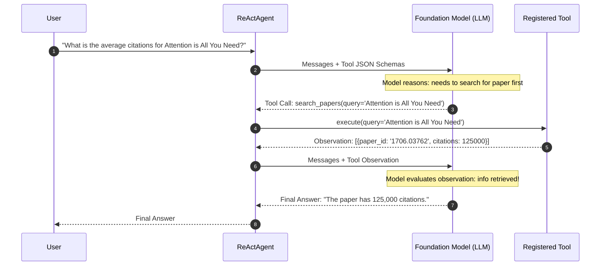

# Lab 1: Tool Calling and the ReAct Loop

In this laboratory, you will build the foundational core of any agentic system: **tool invocation** and the **ReAct (Reasoning + Acting)** execution loop.

---

## 1. General Knowledge & Theoretical Background

### Why Do Language Models Need Tools?
Large Language Models (LLMs) are frozen statistical models trained on text tokens. Despite their reasoning prowess, they suffer from three fundamental limitations:
1. **Knowledge Cutoffs & Static Datasets**: They cannot consult up-to-the-minute academic literature or internal databases.
2. **Arithmetic Inaccuracies**: Autoregressive next-token prediction is notoriously unreliable for multi-step arithmetic, floating-point operations, and statistical aggregation.
3. **Inability to Affect Real-world State**: Pure LLMs cannot query APIs, run code, read files, or execute queries without an agentic runtime.

### Function Calling via Structured JSON Schemas
To let an LLM invoke code, modern foundation models use **Function Calling (Tool Calling)**. The developer supplies the model with a list of callable tools defined as **JSON Schemas**. The model generates a structured JSON object containing the tool name and validated arguments instead of free-form text.



### The ReAct Paradigm (Reason + Act)
Formulated by [Yao et al. (2022)](https://arxiv.org/abs/2210.03629), the ReAct framework interleaves reasoning ("Thought"), action dispatching ("Action"), and environmental feedback ("Observation"):

```text
User Query ──> [Thought] (Model Reasoning)
           ──> [Action] (Tool Call)
           ──> [Observation] (Tool Output)
           ──> ... ──> Final Answer
```

- **Thought**: Allows the model to maintain state, plan sub-goals, and critique previous outputs.
- **Action**: Interacts with external APIs or deterministic computational tools.
- **Observation**: Feeds the real-world tool execution output back into the conversation context as ground truth.
- **Termination & Guardrails**: If the model determines that it has sufficient information, it returns a final answer without requesting tool calls. If an agent enters an infinite loop, a hard `max_iterations` counter forces graceful termination.

---

## 2. Architecture & Code Structure

The files for Lab 1 are located in `labs/01-tool-calling/`:

```text
labs/01-tool-calling/
├── tools.py          # Tool registry, JSON schema generator, and research tools
├── react_agent.py    # ReAct execution loop and tool dispatcher
├── run_lab.py        # Interactive CLI runner
└── test_lab.py       # pytest suite
```

### Core Classes
- **`Tool` (`shared/agent.py`)**: Encapsulates a Python callable, its name, description, and auto-generated JSON schema.
- **`ToolRegistry` (`tools.py`)**: Stores registered tools, provides JSON schemas formatted for OpenAI tool calling, and looks up tools by name.
- **`ReActAgent` (`react_agent.py`)**: Manages the message history, communicates with the LLM via `BaseLLMClient`, inspects model responses, calls tools, and logs events.

---

## 3. What Has Been Pre-Written for You

To help you focus on agentic principles rather than boilerplate, the following components are already implemented:
1. **`generate_json_schema(func)` (`tools.py`)**: Automatically reflects Python type annotations (`str`, `int`, `float`, `bool`, `list`) and docstrings into compliant OpenAPI/JSON Schema parameter objects.
2. **`search_papers(query, limit)` (`tools.py`)**: Searches academic papers from the curated dataset or Crossref fallback.
3. **Loop Skeleton & Message Init (`react_agent.py`)**: Message context initialization (`system`, `user`), iteration tracking, thought logging, and loop termination detection (`if not response.tool_calls:`).
4. **Tool Lookup & JSON Deserialization (`react_agent.py`)**: Resolves tool names in the registry and safely parses stringified JSON argument payloads.

---

## 4. Student Tasks (What You Need to Do)

### Task 1.1: Safe Mathematical Calculator Tool
**File:** `labs/01-tool-calling/tools.py` — `calculate(expression: str) -> str`  
**Tag:** `# TODO [Lab 1.1]` (~30 lines)

Language models frequently produce arithmetic hallucinations. Your task is to implement an arithmetic tool.
> [!CAUTION]
> **Security Warning**: NEVER use Python's built-in `eval()` or `exec()` for arithmetic! Using `eval()` allows Arbitrary Code Execution (e.g. `__import__('os').system('rm -rf /')`).

**Requirements:**
1. Parse `expression` using Python's `ast` (Abstract Syntax Tree) module (`ast.parse(..., mode='eval')`).
2. Recursively evaluate only safe nodes: `ast.Constant`, `ast.BinOp`, `ast.UnaryOp`.
3. Support operators: addition (`+`), subtraction (`-`), multiplication (`*`), division (`/`), exponentiation (`**`), and modulo (`%`).
4. Catch `ZeroDivisionError` and return `"Error: Division by zero"`.
5. Return the result formatted as a string (round floats to 4 decimal places).

---

### Task 1.2: Multi-Paper Citation Statistics Tool
**File:** `labs/01-tool-calling/tools.py` — `compute_citation_stats(paper_ids: List[str]) -> str`  
**Tag:** `# TODO [Lab 1.2]` (~30 lines)

Researchers need comparative bibliometrics. Implement a tool that computes key citation statistics for a list of paper IDs.

**Requirements:**
1. For each `paper_id` in `paper_ids`, locate the paper in `RESEARCH_DATASET`.
2. Collect citation counts. If no valid papers are found, return `json.dumps({"error": "No valid papers found"})`.
3. Compute:
   - `total_citations`: Sum of citations.
   - `average_citations`: Mean citation count rounded to 1 decimal place.
   - `max_citations`: Highest citation count.
   - `min_citations`: Lowest citation count.
   - `h_index`: Number *h* such that *h* papers have at least *h* citations each.
4. Return the computed statistics as an indented JSON string (`indent=2`).

---

### Task 1.3: Execute Tool Call & Format Observation
**File:** `labs/01-tool-calling/react_agent.py` — `_execute_tool_call(tool_call: ToolCall) -> str`  
**Tag:** `# TODO [Lab 1.3]` (~15 lines)

The agent has received a tool call from the model and validated the arguments. Now complete the execution pipeline:

**Requirements:**
1. Log the action event: `self.logger.action(tool_call.name, args)`.
2. Execute the tool: `raw_result = tool.execute(**args)` inside a `try / except` block.
3. Format the result into a clean observation string:
   - If `raw_result` is a `dict` or `list`, serialize with `json.dumps(raw_result, indent=2)`.
   - Otherwise, convert to `str(raw_result)`.
4. Log the observation event: `self.logger.observation(result_str)`.
5. Return `result_str`. If an exception occurs, catch it and return `"Error executing tool: <error>"`.

---

### Task 1.4: Handle Tool Calls in the ReAct Loop
**File:** `labs/01-tool-calling/react_agent.py` — `run(user_query: str) -> str`  
**Tag:** `# TODO [Lab 1.4]` (~15 lines)

When the model responds with one or more tool calls (`response.tool_calls`), you must update the conversational state so the LLM can observe the results in the subsequent turn:

**Requirements:**
1. Append an assistant message to `self.messages`:
   ```python
   self.messages.append(
       Message(
           role="assistant",
           content=thought_text,
           tool_calls=response.tool_calls,
       )
   )
   ```
2. Iterate through each tool call `tc` in `response.tool_calls`:
   - Execute the call: `obs = self._execute_tool_call(tc)`
   - Append a tool message to `self.messages`:
     ```python
     self.messages.append(
         Message(
             role="tool",
             name=tc.name,
             tool_call_id=tc.id,
             content=obs,
         )
     )
     ```

---

## 5. Verification & Testing

### Interactive Execution
Run the lab script to watch the agent reason through sample inquiries:
```bash
python3 labs/01-tool-calling/run_lab.py
```

### Automated Unit Tests
Run the test suite to verify your solution:
```bash
python3 -m pytest labs/01-tool-calling/test_lab.py
```

Expected output upon successful completion:
```text
test_safe_calculator PASSED
test_citation_stats PASSED
test_execute_tool_call PASSED
test_react_agent_full_loop PASSED
test_iteration_limit PASSED
...
8 passed in 0.25s
```
