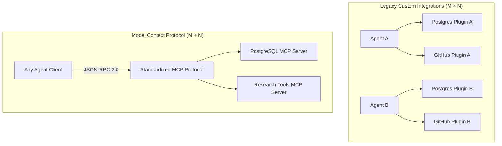
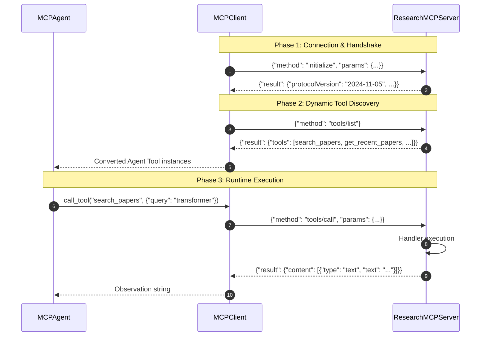

# Lab 2: Model Context Protocol (MCP)

In this laboratory, you will expose bibliographic capabilities through the **Model Context Protocol (MCP)**—the emerging open standard for connecting AI models to data sources and tools—and build a client that dynamically discovers and invokes these remote capabilities.

---

## 1. General Knowledge & Theoretical Background

### The M × N Integration Dilemma
Historically, every AI framework (LangChain, LlamaIndex, AutoGen, custom agents) implemented its own tool format. If you had *M* agent frameworks and *N* enterprise data sources (GitHub, PostgreSQL, Slack, academic databases), the community had to write *M* × *N* custom plugins.



### What is the Model Context Protocol (MCP)?
Open-sourced by Anthropic in late 2024, **MCP** is an open specification that standardizes how applications provide context and tools to LLMs.
Key properties of MCP:
1. **Decoupled Architecture**: Tools run in isolated server processes or remote microservices, separating tool execution security and environment dependencies from the agent runtime.
2. **JSON-RPC 2.0 Foundation**: All messages conform to the standard JSON-RPC 2.0 specification over standard I/O (`stdio`), HTTP with Server-Sent Events (SSE), or WebSockets.
3. **Dynamic Discovery**: The agent does not need compile-time knowledge of available tools. Upon connecting, it queries `tools/list` to introspect schemas at runtime.

### JSON-RPC 2.0 Message Structure
Every MCP message is a JSON string terminating in a newline (`\n`):

#### 1. Request (`Client -> Server`):
```json
{
  "jsonrpc": "2.0",
  "id": 1,
  "method": "tools/call",
  "params": {
    "name": "search_papers",
    "arguments": {"query": "deep learning"}
  }
}
```

#### 2. Success Response (`Server -> Client`):
```json
{
  "jsonrpc": "2.0",
  "id": 1,
  "result": {
    "content": [
      {
        "type": "text",
        "text": "[{\"title\": \"Deep Learning\", \"year\": 2015}]"
      }
    ],
    "isError": false
  }
}
```

#### 3. Error Response (`Server -> Client`):
```json
{
  "jsonrpc": "2.0",
  "id": 1,
  "error": {
    "code": -32601,
    "message": "Method/Tool 'unknown_tool' not found"
  }
}
```

---

## 2. Architecture & Code Structure

The files for Lab 2 are located in `labs/02-mcp/`:

```text
labs/02-mcp/
├── server.py       # Standalone ResearchMCPServer (JSON-RPC 2.0)
├── client.py       # MCPClient (handles stdio process communication)
├── mcp_agent.py    # MCPAgent (integrates discovered tools into ReActAgent)
├── dataset.py      # Curated academic dataset & live Crossref API fallback
├── run_lab.py      # Interactive runner demonstrating live server queries
└── test_lab.py     # pytest suite
```



---

## 3. What Has Been Pre-Written for You

1. **Core Tools (`server.py`)**: `search_papers`, `get_paper_details`, and `export_bibtex` are implemented and pre-registered.
2. **JSON-RPC Dispatcher Boilerplate (`server.py`)**: The protocol parser handles message reading, standard error response generation, `initialize`, `ping`, and `tools/list`.
3. **Transport Plumbing (`client.py`)**: `_send_request` formats and writes messages to child process stdin or in-memory handlers.
4. **Tool Converter (`client.py`)**: `to_agent_tools()` wraps discovered MCP definitions into callable `Tool` instances.

---

## 4. Student Tasks (What You Need to Do)

### Task 2.1: Server-Side Tool Execution Handler
**File:** `labs/02-mcp/server.py` — `handle_request()`  
**Tag:** `# TODO [Lab 2.1]` (~12 lines)

Inside the `method == "tools/call"` routing branch:
1. Lookup the tool handler function in `self.tools[tool_name]["handler"]`.
2. Execute the handler passing `**tool_args` within a `try / except` block.
3. On success, return a JSON-RPC 2.0 response with:
   ```json
   "result": {
     "content": [{"type": "text", "text": str(res)}],
     "isError": false
   }
   ```
4. On exception, return the same structure with:
   ```json
   "result": {
     "content": [{"type": "text", "text": f"Error: {e}"}],
     "isError": true
   }
   ```

---

### Task 2.2: Implement Missing Academic MCP Tools
**File:** `labs/02-mcp/server.py`

#### 2.2a: `get_recent_papers(topic: str, limit: int = 5)`
**Tag:** `# TODO [Lab 2.2a]` (~10 lines)
1. Search `RESEARCH_DATASET` for entries matching `topic` in the title or `topics` list (case-insensitive).
2. Sort results descending by publication year, then descending by citation count.
3. Return the top `limit` papers as an indented JSON string (`indent=2`).

#### 2.2b: `get_author_papers(author_name: str)`
**Tag:** `# TODO [Lab 2.2b]` (~15 lines)
1. Match `author_name` case-insensitively against authors in `RESEARCH_DATASET`.
2. Extract: `paper_id`, `title`, `year`, and `citations`.
3. Sort results descending by publication year.
4. Return as an indented JSON string (`indent=2`).

---

### Task 2.3: Register New Tools with JSON Schema
**File:** `labs/02-mcp/server.py` — `_register_default_tools()`  
**Tag:** `# TODO [Lab 2.3]` (~30 lines)

Register `get_recent_papers` and `get_author_papers` using `self.register_tool()`. Include full OpenAPI parameter definitions with parameter types and required fields.

---

### Task 2.4: Client Connection, Tool Discovery & Agent Registration
**Files:** `labs/02-mcp/client.py` and `labs/02-mcp/mcp_agent.py`

1. **`client.py` — `connect()`** (`# TODO [Lab 2.4a]`):
   - If `self.in_memory_server` is `None` and `self.server_path` is provided, spawn the server process via `subprocess.Popen([sys.executable, self.server_path], stdin=PIPE, stdout=PIPE, text=True)`.
   - Send the `"initialize"` JSON-RPC request and verify the handshake response.
2. **`client.py` — `list_tools()`** (`# TODO [Lab 2.4b]`):
   - Send a `"tools/list"` request.
   - Cache results in `self.discovered_tools` and return the list.
3. **`mcp_agent.py` — `_load_mcp_tools()`** (`# TODO [Lab 2.4]`):
   - Call `self.mcp_client.to_agent_tools()`.
   - Add each tool `t` to `self.tool_registry._tools[t.name] = t`.
   - Log the discovered tool count.

---

### Task 2.5: Remote Tool Invocation & Agent Wiring
**Files:** `labs/02-mcp/client.py` and `labs/02-mcp/mcp_agent.py`

1. **`client.py` — `call_tool(tool_name, arguments)`** (`# TODO [Lab 2.5]`):
   - Send a `"tools/call"` request with `name` and `arguments`.
   - Parse `result["content"]`, extract items with `type == "text"`, and join them with newlines.
2. **`mcp_agent.py` — `__init__()`** (`# TODO [Lab 2.5]`):
   - Instantiate `self.react_agent = ReActAgent(...)` using the populated tool registry and the dedicated `MCP_SYSTEM_PROMPT`.

---

## 5. Verification & Testing

### Interactive Execution
Run the lab script:
```bash
python3 labs/02-mcp/run_lab.py
```

### Automated Unit Tests
```bash
python3 -m pytest labs/02-mcp/test_lab.py
```

Expected output:
```text
test_server_initialize_and_ping PASSED
test_server_tools_list PASSED
test_server_tool_execution PASSED
test_get_recent_and_author_papers PASSED
test_client_roundtrip PASSED
test_mcp_agent_end_to_end PASSED
...
6 passed in 0.30s
```
