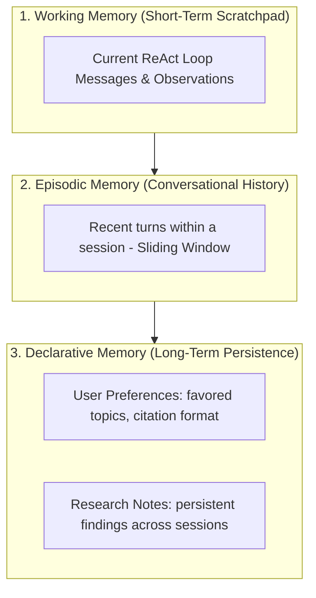
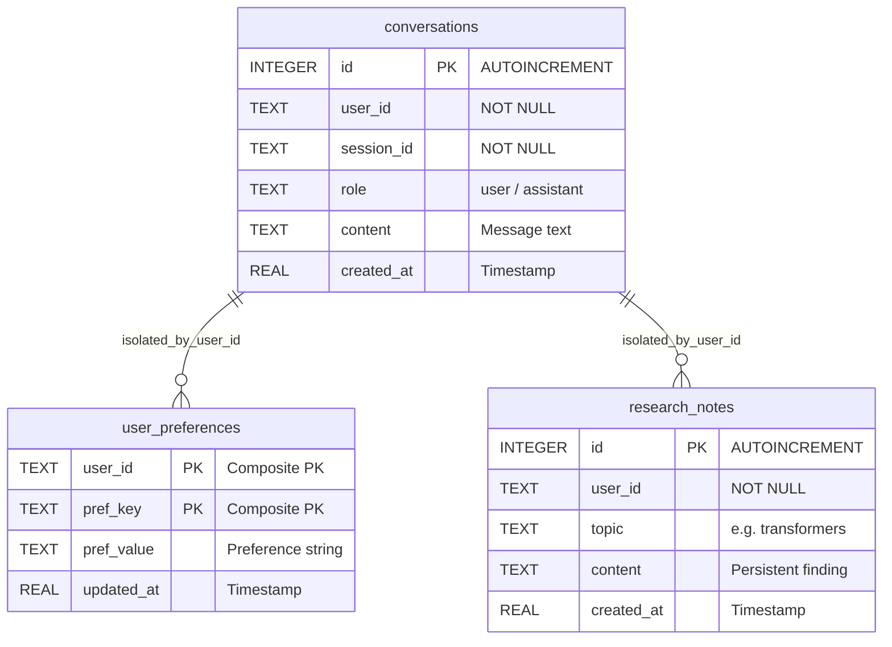

# Lab 3: Agent Memory & Personalization

In this laboratory, you will implement a multi-tiered **memory hierarchy** using SQLite, empowering your Research Assistant to remember student research interests, track ongoing sessions, and respect strict user-level data isolation.

---

## 1. General Knowledge & Theoretical Background

### Why Can't We Keep Everything in the Context Window?
Foundation models now advertise context windows of hundreds of thousands of tokens. However, naive "stuff-the-context" approaches suffer from three fatal flaws:
1. **Financial & Latency Cost**: Inference cost scales linearly with prompt token length; time-to-first-token (TTFT) degrades rapidly.
2. **"Lost in the Middle" Attention Drift**: Studies (e.g. [Liu et al., 2023](https://arxiv.org/abs/2307.03172)) show models retrieve information from the beginning and end of long contexts far more accurately than from the middle.
3. **Session Amnesia**: Context windows are volatile in-memory buffers. When the process restarts or a new session begins, all conversational history evaporates.

### The Agent Memory Taxonomy
Production agent architectures partition memory into distinct tiers:



### Relational Storage vs. Vector Databases
While vector databases excel at fuzzy semantic search over millions of documents, **relational storage (SQLite)** is far superior for user-isolated agent memory:
- **ACID Guarantees**: Updates and deletes are atomic and consistent.
- **Strict User Isolation**: Enforcing `WHERE user_id = ?` mathematically prevents information leakage between different users.
- **Privacy & Compliance (GDPR)**: Deleting user data is a deterministic `DELETE FROM ... WHERE user_id = ?` query, whereas removing embeddings from HNSW vector index graphs is complex and non-deterministic.

---

## 2. Architecture & Database Schema

The files for Lab 3 are located in `labs/03-memory/`:

```text
labs/03-memory/
├── storage.py          # SQLite engine (table schemas, isolation queries, upserts)
├── memory_manager.py   # Sliding window, context injection, and memory tools
├── memory_agent.py     # End-to-end memory-augmented ReAct assistant
├── run_lab.py          # Multi-user, multi-session interactive demo
└── test_lab.py         # pytest suite
```

### Database Schema Design
Your SQLite database (`agent_memory.db`) consists of three tables:



> [!IMPORTANT]
> Notice the compound primary key `PRIMARY KEY (user_id, pref_key)` on `user_preferences`. This ensures that each user has exactly one value per preference key, enabling clean SQL **UPSERT** (`INSERT ... ON CONFLICT DO UPDATE`) semantics!

---

## 3. What Has Been Pre-Written for You

1. **`conversations` Table & Queries (`storage.py`)**: The conversation table DDL, indexing on `(user_id, session_id)`, `save_message()`, and `get_conversation_history()` are fully implemented.
2. **`delete_preference()` (`storage.py`)**: A pre-written helper that deletes a specific preference key for a user.
3. **Turn Recording Plumbing (`memory_manager.py`)**: `record_turn()` routes messages directly to storage.

---

## 4. Student Tasks (What You Need to Do)

### Task 3.1: Initialize SQLite Database Schema
**File:** `labs/03-memory/storage.py` — `_init_db()`  
**Tag:** `# TODO [Lab 3.1]` (~25 lines)

The `conversations` table is already created. Complete the method by executing the DDL queries for the remaining two tables:
1. `user_preferences`:
   - `user_id TEXT NOT NULL`
   - `pref_key TEXT NOT NULL`
   - `pref_value TEXT NOT NULL`
   - `updated_at REAL NOT NULL`
   - `PRIMARY KEY (user_id, pref_key)`
2. `research_notes`:
   - `id INTEGER PRIMARY KEY AUTOINCREMENT`
   - `user_id TEXT NOT NULL`
   - `topic TEXT NOT NULL`
   - `content TEXT NOT NULL`
   - `created_at REAL NOT NULL`
   - Create index `idx_notes_user_topic ON research_notes (user_id, topic)`

---

### Task 3.2: User Preference Persistence with Strict Isolation
**File:** `labs/03-memory/storage.py`

#### 3.2a: `save_preference(user_id: str, key: str, value: str)`
**Tag:** `# TODO [Lab 3.2a]` (~20 lines)
- Strip and lowercase the `key`; strip the `value`.
- Insert into `user_preferences` using SQLite's `ON CONFLICT(user_id, pref_key) DO UPDATE`:
  ```sql
  INSERT INTO user_preferences (user_id, pref_key, pref_value, updated_at)
  VALUES (?, ?, ?, ?)
  ON CONFLICT(user_id, pref_key) DO UPDATE SET
      pref_value = excluded.pref_value,
      updated_at = excluded.updated_at
  ```

#### 3.2b: `get_preferences(user_id: str) -> Dict[str, str]`
**Tag:** `# TODO [Lab 3.2b]` (~15 lines)
- Execute `SELECT pref_key, pref_value FROM user_preferences WHERE user_id = ?`.
- Return a dictionary mapping `{pref_key: pref_value}`.
- **Critical Security Invariant**: Never return rows belonging to another `user_id`!

---

### Task 3.3: User Memory Data Erasure (GDPR Compliance)
**File:** `labs/03-memory/storage.py` — `clear_user_data(user_id: str)`  
**Tag:** `# TODO [Lab 3.3]` (~20 lines)

Execute `DELETE FROM` statements across `conversations`, `user_preferences`, and `research_notes` filtered strictly by `WHERE user_id = ?`.

---

### Task 3.4: Context Injection & Memory-Augmented Agent Loop
**Files:** `labs/03-memory/memory_manager.py` and `labs/03-memory/memory_agent.py`

#### 3.4a: `get_system_context(user_id: str) -> str` (`memory_manager.py`)
**Tag:** `# TODO [Lab 3.4a]` (~30 lines)
Fetch preferences and notes for `user_id`. If non-empty, format them into an injection block:
```text
[PERSISTENT STUDENT RESEARCH MEMORY]
Student Preferences:
  • topic_interest: Reinforcement Learning
Student Research Notes:
  • [RL] PPO achieves state of the art on MuJoCo benchmarks
```

#### 3.4b: `get_recent_history(user_id, session_id)` (`memory_manager.py`)
**Tag:** `# TODO [Lab 3.4b]` (~15 lines)
Fetch the last `max_history_turns * 2` messages and return them formatted as a list of `{"role": ..., "content": ...}` dictionaries.

#### 3.4c: `run(...)` (`memory_agent.py`)
**Tag:** `# TODO [Lab 3.4]` (~35 lines)
1. Retrieve `memory_context = self.memory.get_system_context(user_id)`.
2. Construct the tool registry, augmenting it with memory tools (`self.memory.get_memory_tools(user_id)`).
3. Append `memory_context` to `self.system_prompt` if present.
4. Instantiate `ReActAgent` and run the user query.
5. Record the conversation turn in storage via `self.memory.record_turn(...)`.

---

### Task 3.5: Autonomous Memory Self-Management Tools
**File:** `labs/03-memory/memory_manager.py` — `get_memory_tools(user_id: str) -> List[Tool]`  
**Tag:** `# TODO [Lab 3.5]` (~45 lines)

Provide the agent with tools so it can autonomously update the user's memory when the user states facts:
1. `save_preference(key: str, value: str)`: Saves a preference.
2. `get_preferences()`: Returns the user's stored preferences.
3. `save_research_note(topic: str, note: str)`: Saves a persistent finding.
4. `clear_memory()`: Clears the user's data.

---

## 5. Verification & Testing

### Interactive Execution
Run the multi-user simulation:
```bash
python3 labs/03-memory/run_lab.py
```
Notice how User 1 (`alice`) sets a preference for "Multi-Agent Systems", User 2 (`bob`) queries papers independently without seeing Alice's data, and Alice resumes in a new session with her preferences preserved!

### Automated Unit Tests
```bash
python3 -m pytest labs/03-memory/test_lab.py
```

Expected output:
```text
test_init_db_creates_all_tables PASSED
test_save_and_get_preferences PASSED
test_preference_upsert_behavior PASSED
test_user_isolation_guarantee PASSED
test_clear_user_data PASSED
test_memory_injection_formatting PASSED
test_agent_memory_persistence_and_personalization PASSED
...
7 passed in 0.35s
```
