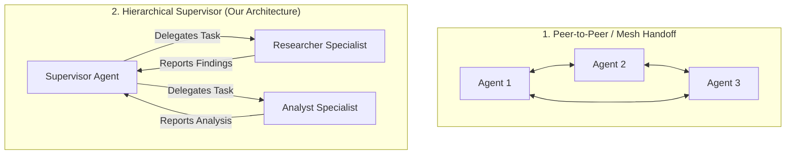
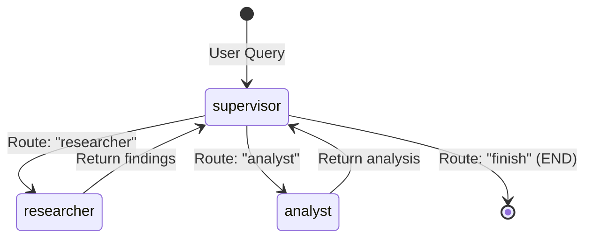

# Lab 4: Multi-Agent Systems & LangGraph Orchestration

In this laboratory, you will build a hierarchical **multi-agent research consortium** powered by **LangGraph**. You will implement specialized agents (Supervisor, Researcher, Analyst), model their interactions as a cyclical state machine, and enforce delegation safety guardrails.

---

## 1. General Knowledge & Theoretical Background

### Why Move from Single-Agent to Multi-Agent?
Single-agent systems handle focused tasks well. However, as task complexity scales, single agents hit serious walls:
1. **Prompt Congestion & Role Confusion**: Cramming paper search instructions, mathematical analysis rules, literature synthesis guidelines, and formatting constraints into a single system prompt degrades LLM instruction-following.
2. **Context Window Contamination**: Raw search dumps and intermediate data pollute the context, causing the model to lose track of the original high-level goal.
3. **Lack of Specialization**: Different sub-tasks require different tool subsets, reasoning temperatures, and prompt personas.

### Architectural Patterns in Multi-Agent Systems
There are two primary paradigms for coordinating multiple AI agents:



In this lab, we adopt the industry-standard **Hierarchical Supervisor-Worker** pattern. The Supervisor acts as the central orchestrator: it decomposes the user's inquiry, delegates atomic tasks to specialized workers, inspects their output, and synthesizes the final report.

### LangGraph: Graph-Based Agent State Machines
Built on top of LangChain, **LangGraph** models multi-agent workflows as stateful graphs:
- **`AgentState`**: A shared, immutable state dictionary passed between nodes.
- **Nodes**: Python functions or agents that receive the current state, perform computation or tool calls, and return partial state updates.
- **Edges & Conditional Edges**: Directed transitions connecting nodes. Conditional edges inspect the Supervisor's decision to route execution dynamically (e.g. to `researcher`, `analyst`, or `finish`).
- **Cyclical Graphs**: Unlike traditional DAGs (Directed Acyclic Graphs), LangGraph natively supports cycles (e.g. `supervisor -> researcher -> supervisor -> analyst -> supervisor -> finish`).
- **Checkpointers (`MemorySaver`)**: Persists the graph state at each super-step, enabling replay and fault tolerance.

---

## 2. Architecture & State Graph Topology

The files for Lab 4 are located in `labs/04-multi-agent/`:

```text
labs/04-multi-agent/
├── schemas.py          # AgentState TypedDict and SharedContext dataclasses
├── specialists.py      # ResearcherSpecialist and AnalystSpecialist
├── supervisor.py       # ResearchSupervisor (decomposition, routing, synthesis)
├── orchestrator.py     # LangGraph StateGraph builder, cycle detector, and runner
├── run_lab.py          # Interactive consortium execution demo
└── test_lab.py         # pytest suite
```

### The Multi-Agent State Machine



---

## 3. What Has Been Pre-Written for You

1. **State Schemas (`schemas.py`)**: `AgentState(TypedDict)` with reducers, `SharedContext`, and conversion methods (`to_agent_state()`, `from_agent_state()`).
2. **Specialist Node Wrappers (`specialists.py`)**: `node_function(state: AgentState) -> Dict[str, Any]` bridges each specialist to the LangGraph node calling convention.
3. **Report Synthesis (`supervisor.py`)**: `synthesize_report()` aggregates findings into a cohesive academic briefing.
4. **Embedded LangGraph Engine (`orchestrator.py`)**: An embedded fallback engine ensures tests and execution succeed even if the external `langgraph` package is not pre-installed.

---

## 4. Student Tasks (What You Need to Do)

### Task 4.1: Research Specialist Execution
**File:** `labs/04-multi-agent/specialists.py` — `ResearcherSpecialist.execute_task()`  
**Tag:** `# TODO [Lab 4.1]` (~35 lines)

The Research Specialist searches for papers and retrieves metadata:
1. Search papers matching `task.description` using the pre-registered research tools.
2. If papers are found:
   - Extract paper details (ID, title, authors, year, citations, abstract).
   - Format a structured findings summary string.
3. If no papers are found, formulate an informative fallback message.
4. Store findings in `context.research_findings[task.id]` and return the findings string.

---

### Task 4.2: Analysis Specialist Execution
**File:** `labs/04-multi-agent/specialists.py` — `AnalysisSpecialist.execute_task()`  
**Tag:** `# TODO [Lab 4.2]` (~40 lines)

The Analysis Specialist analyzes retrieved literature:
1. Gather all raw literature from `context.research_findings`.
2. Extract common methodologies, key theoretical contributions, and publication trends.
3. Calculate citation aggregates across the papers.
4. Format an analytical critique and store the result in `context.analysis_results[task.id]`.

---

### Task 4.3: Supervisor Task Planning & Delegation
**File:** `labs/04-multi-agent/supervisor.py` — `plan_and_delegate()`  
**Tag:** `# TODO [Lab 4.3]` (~45 lines)

The Supervisor inspects the current state and decides the next step:
1. If no research has been conducted (`not context.research_findings`):
   - Create a research `TaskAssignment` targeting the `"researcher"`.
   - Record the delegation in `context.delegation_history`.
   - Return `"researcher"`.
2. If research is complete but analysis is missing (`not context.analysis_results`):
   - Create an analysis `TaskAssignment` targeting the `"analyst"`.
   - Record the delegation in `context.delegation_history`.
   - Return `"analyst"`.
3. If both research and analysis are complete:
   - Call `self.synthesize_report(context)` to populate `context.final_synthesis`.
   - Return `"finish"`.

---

### Task 4.4: Construct the LangGraph StateGraph
**File:** `labs/04-multi-agent/orchestrator.py` — `_build_langgraph()`  
**Tag:** `# TODO [Lab 4.4]` (~30 lines)

Construct and compile the state machine:
1. Instantiate `workflow = StateGraph(AgentState)`.
2. Register nodes:
   - `"supervisor"`: `self.supervisor.node_function`
   - `"researcher"`: `self.supervisor.researcher.node_function`
   - `"analyst"`: `self.supervisor.analyst.node_function`
3. Add conditional edge from `"supervisor"` using `route_supervisor_decision` with mapping:
   ```python
   {"researcher": "researcher", "analyst": "analyst", "finish": END}
   ```
4. Add return edges:
   - `workflow.add_edge("researcher", "supervisor")`
   - `workflow.add_edge("analyst", "supervisor")`
5. Set entry point to `"supervisor"`.
6. Return `workflow.compile(checkpointer=self.checkpointer)`.

---

### Task 4.5: Cyclic Loop Detection & Execution Harness
**File:** `labs/04-multi-agent/orchestrator.py`

#### 4.5a: `detect_cycle(history: List[Any]) -> bool`
**Tag:** `# TODO [Lab 4.5a]` (~20 lines)
Prevent ping-pong delegation loops between agents:
- If `len(history) < 4`, return `False`.
- Extract `(source, target)` tuples for each delegation hop.
- If `hops[-1] == hops[-3]` and `hops[-2] == hops[-4]`, a repeating 2-cycle is occurring—return `True`.

#### 4.5b: `execute_workflow(user_query: str) -> SharedContext`
**Tag:** `# TODO [Lab 4.5b]` (~25 lines)
1. Initialize `AgentState` with `query=user_query`, empty collections, and `next_step="supervisor"`.
2. Invoke the compiled graph: `final_state = self.app.invoke(initial_state, config=config)`.
3. Check for cycles via `self.detect_cycle(final_state["delegation_history"])`.
4. Convert `final_state` to `SharedContext` and return it.

---

## 5. Verification & Testing

### Interactive Execution
Watch the supervisor coordinate the specialists in real time:
```bash
python3 labs/04-multi-agent/run_lab.py
```

### Automated Unit Tests
```bash
python3 -m pytest labs/04-multi-agent/test_lab.py
```

Expected output:
```text
test_researcher_specialist_execution PASSED
test_analyst_specialist_execution PASSED
test_supervisor_planning_and_delegation PASSED
test_langgraph_workflow_execution PASSED
test_cycle_detection_stops_infinite_delegation PASSED
test_shared_context_state_preservation PASSED
...
6 passed in 0.40s
```
