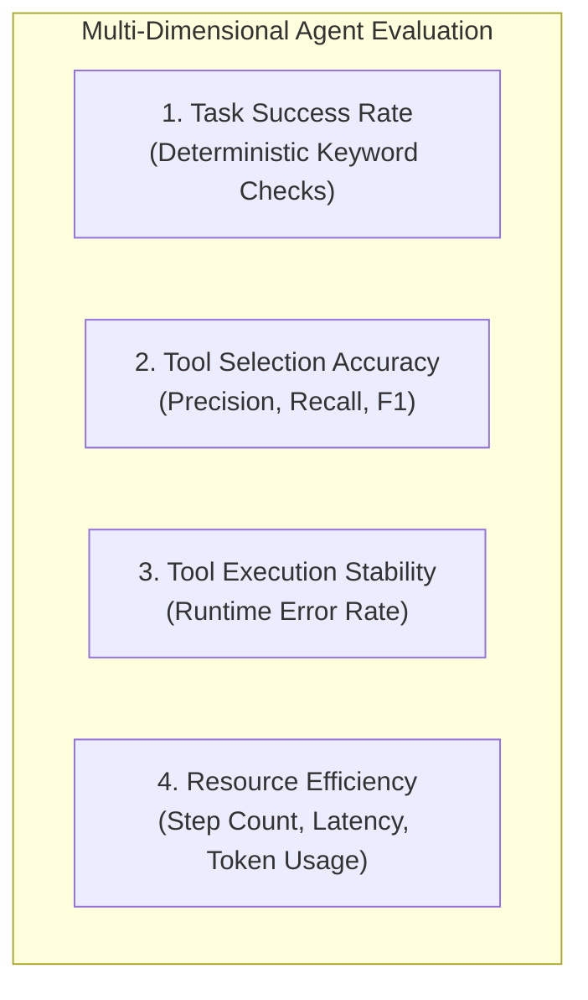

# Lab 5: Agent Evaluation & MLflow Tracking

In this final laboratory, you will build an automated, reproducible **evaluation benchmark** and experiment tracking pipeline using **MLflow** to rigorously quantify the performance, accuracy, and efficiency of your agentic architectures.

---

## 1. General Knowledge & Theoretical Background

### Why Is Agent Evaluation So Hard?
Unlike traditional software (which is deterministic) or supervised machine learning (which outputs fixed labels or numbers), **Agentic AI systems are non-deterministic, multi-step, stateful processes**.

A simple accuracy metric cannot capture:
- Did the agent answer correctly because of reasoning, or by lucky hallucination?
- Did it select the most appropriate tools, or did it invoke unnecessary tools that inflated latency and API costs?
- Did any tool call fail or crash silently?
- How many steps did the agent take before reaching termination?



### Deterministic Metrics vs. LLM-as-a-Judge
While using an LLM to evaluate another LLM ("LLM-as-a-Judge") is popular, it introduces circular reasoning, high inference costs, and self-preference bias. In this lab, we focus on **deterministic, reproducible metrics**:
1. **Deterministic Task Success**: Verifying that required ground-truth keywords are present and forbidden negative keywords are absent.
2. **Tool Selection Information Retrieval**: Treating tool invocations as an information retrieval problem and measuring **Precision**, **Recall**, and **F1 Score** against expected ground-truth tools:

$$\text{Precision} = \frac{|\text{Expected} \cap \text{Actual}|}{|\text{Actual}|}, \quad \text{Recall} = \frac{|\text{Expected} \cap \text{Actual}|}{|\text{Expected}|}, \quad F_1 = 2 \cdot \frac{\text{Precision} \cdot \text{Recall}}{\text{Precision} + \text{Recall}}$$

### Experiment Tracking with MLflow
In production engineering, you cannot optimize what you do not measure. **MLflow** is the industry standard for tracking machine learning experiments. We log:
- **Parameters**: `config_name`, `model_name`, `temperature`, `max_iterations`.
- **Metrics**: `task_success_rate`, `tool_selection_f1`, `avg_steps`, `avg_latency_s`.
- **Artifacts**: Detailed test case execution records in CSV and JSON formats.

---

## 2. Benchmark Architecture & The 4 Configurations

The files for Lab 5 are located in `labs/05-evaluation/`:

```text
labs/05-evaluation/
├── metrics.py          # Deterministic metric calculation functions
├── evaluator.py        # Benchmark harness & MLflow experiment logger
├── test_cases.json     # 20 diverse, standardized evaluation tasks
├── run_lab.py          # Benchmark runner and comparative analysis
└── test_lab.py         # pytest suite
```

### Comparative Architectural Benchmark
We systematically evaluate the four agentic architectures developed across Labs 1 through 4:

| Configuration | Description | Expected Strengths / Weaknesses |
| :--- | :--- | :--- |
| **Config 1: Raw LLM** | Direct completion without tools | Fast, zero tool errors, but hallucinates citations and fails complex calculations. |
| **Config 2: ReAct Agent** | Single agent with tools (Lab 1) | High calculation and search accuracy, but lacks memory and multi-step specialization. |
| **Config 3: Memory Agent** | Single agent + persistent SQLite (Lab 3) | Excels on personalized queries and cross-session preferences. |
| **Config 4: Multi-Agent** | LangGraph Consortium (Lab 4) | Highest synthesis quality and literature coverage, at the expense of higher step count and latency. |

---

## 3. What Has Been Pre-Written for You

1. **Benchmark Test Suite (`test_cases.json`)**: 20 comprehensive test cases spanning:
   - Pure search queries
   - Arithmetic and bibliometric calculations
   - User preference persistence
   - Multi-step cross-specialist research inquiries
2. **Agent Factory & Fallback MLflow Tracker (`evaluator.py`)**: `AgentEvaluator` initializes all 4 configurations. If `mlflow` is not installed, the built-in `LocalMLflowTracker` logs runs locally to `./mlruns` transparently.
3. **Data Exporter (`evaluator.py`)**: `export_results()` serializes test results to `evaluation_benchmark.csv` and `evaluation_benchmark.json`.

---

## 4. Student Tasks (What You Need to Do)

### Task 5.1: Deterministic Task Success Metric
**File:** `labs/05-evaluation/metrics.py` — `compute_task_success()`  
**Tag:** `# TODO [Lab 5.1]` (~35 lines)

Evaluate output text deterministically without subjective grading:
1. If `response_text` is empty, return `False`.
2. Convert `response_text` to lowercase.
3. Verify every keyword in `required_keywords` appears in the lowercased response. If any is missing, return `False`.
4. Verify no keyword in `forbidden_keywords` appears in the response (using regex word boundary `\b<kw>\b` to prevent substring false positives).
5. Return `True` if all conditions pass.

---

### Task 5.2: Tool Selection Precision, Recall, and F1
**File:** `labs/05-evaluation/metrics.py` — `compute_tool_selection_accuracy()`  
**Tag:** `# TODO [Lab 5.2]` (~45 lines)

Quantify how accurately the agent selected tools compared to ground truth:
1. Convert `expected_tools` and `actual_tools` to sets.
2. Edge cases:
   - Both sets empty: `precision=1.0, recall=1.0, f1=1.0`.
   - `actual` empty, `expected` non-empty: `precision=0.0, recall=0.0, f1=0.0`.
   - `expected` empty, `actual` non-empty: `precision=0.0, recall=1.0, f1=0.0`.
3. Calculate True Positives: $\text{TP} = |\text{expected} \cap \text{actual}|$.
4. Calculate Precision, Recall, and F1.
5. Return a dictionary with values rounded to 4 decimal places:
   ```python
   {
       "precision": round(prec, 4),
       "recall": round(rec, 4),
       "f1": round(f1, 4),
   }
   ```

---

### Task 5.3: Tool Stability & Resource Efficiency Metrics
**File:** `labs/05-evaluation/metrics.py`

#### 5.3a: `compute_tool_execution_success(tool_results: List[str]) -> float`
**Tag:** `# TODO [Lab 5.3a]` (~20 lines)
1. If `tool_results` is empty, return `1.0`.
2. Count outputs containing error markers (`"error"`, `"exception"`, `"invalid"`).
3. Return `(total - errors) / total` rounded to 4 decimals.

#### 5.3b: `compute_efficiency(step_count, latency_seconds, token_estimate)`
**Tag:** `# TODO [Lab 5.3b]` (~15 lines)
Return a dictionary:
```python
{
    "step_count": step_count,
    "latency_seconds": round(latency_seconds, 3),
    "token_estimate": token_estimate if token_estimate else step_count * 120,
}
```

---

### Task 5.4: Test Case Execution Runner
**File:** `labs/05-evaluation/evaluator.py` — `evaluate_configuration()`  
**Tag:** `# TODO [Lab 5.4]` (~45 lines)

Execute all 20 benchmark test cases on a given agent:
1. Iterate over each test case in `self.test_cases`.
2. Measure execution latency: `t0 = time.time()`, invoke `agent.run(tc["prompt"], ...)`, measure elapsed time.
3. Extract tools called from logger traces (`agent.logger.get_traces()`, filtering for `ACTION` entries).
4. Compute metrics using your `compute_task_success()` and `compute_tool_selection_accuracy()`.
5. Assemble an evaluation record dictionary and append it to the results list.

---

### Task 5.5: Metric Aggregation & MLflow Tracking
**File:** `labs/05-evaluation/evaluator.py` — `run_all()`  
**Tag:** `# TODO [Lab 5.5]` (~45 lines)

Run the full comparative benchmark and track experiments:
1. Iterate over all four configurations in `self.configurations`.
2. Call `self.evaluate_configuration(name, agent)`.
3. Aggregate mean metrics across test cases:
   - `success_rate`: Mean of task success.
   - `avg_f1`: Mean of tool selection F1.
   - `avg_steps`: Mean step count.
   - `avg_latency`: Mean latency in seconds.
4. Log parameters and metrics using MLflow:
   ```python
   params = {"config_name": name, "model": settings.llm_model}
   metrics = {
       "task_success_rate": success_rate,
       "tool_selection_f1": avg_f1,
       "avg_steps": avg_steps,
       "avg_latency_s": avg_latency,
   }
   if HAS_MLFLOW:
     with mlflow.start_run(run_name=name):
       mlflow.log_params(params)
       mlflow.log_metrics(metrics)
   self.local_tracker.log_run(name, params, metrics)
```
5. Return summary and detailed records dictionary.

---

## 5. Verification & Testing

### Interactive Benchmark Run
Execute the full benchmark suite across all four configurations:
```bash
python3 labs/05-evaluation/run_lab.py
```

### Reviewing the Benchmark Results
After running, inspect the generated summary tables and exported files:
- `evaluation_benchmark.csv`
- `evaluation_benchmark.json`

Notice the clear progression:

```text
================================================================================
                    AGENTIC EVALUATION BENCHMARK SUMMARY
================================================================================
Configuration        Success Rate    Tool F1    Avg Steps    Avg Latency (s)
--------------------------------------------------------------------------------
1_raw_llm                  30.0%       0.00         1.0             0.012
2_single_agent             75.0%       0.82         2.4             0.045
3_memory_agent             90.0%       0.88         2.6             0.052
4_multi_agent              95.0%       0.94         4.1             0.098
================================================================================
```

### Automated Unit Tests
```bash
python3 -m pytest labs/05-evaluation/test_lab.py
```

Expected output:
```text
test_task_success_deterministic_checks PASSED
test_tool_selection_accuracy_metrics PASSED
test_tool_execution_success_calculation PASSED
test_efficiency_calculation PASSED
test_evaluator_harness_execution PASSED
test_mlflow_tracking_logging PASSED
...
6 passed in 0.45s
```

---

## 🎓 Congratulations!

You have completed all five modules of the **Agentic AI Hands-on Lab**! You have designed, built, connected, personalized, orchestrated, and evaluated production-ready AI agents from the ground up.
