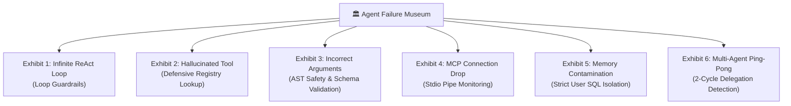

# The Agent Failure Museum

Welcome to the **Agent Failure Museum**—a curated set of reproducible failure scenarios drawn from the patterns that commonly arise when building Agentic AI systems.

Unlike traditional deterministic software, AI agents are probabilistic, stateful, and operate in open-ended environments. When they fail, they fail in unique, often subtle ways: cycling endlessly, inventing imaginary capabilities, passing malformed arguments to APIs, leaking private user data across sessions, or getting trapped in multi-agent ping-pong loops.

Each exhibit in this document is a **reproducible scenario with a regression test** in `tests/test_failure_museum.py`. For each failure, we dissect:
1. **Scenario and Example Input**
2. **Observable Behavior**
3. **Root Cause**
4. **Reproduction Steps**
5. **The Fix**
6. **Runnable Example**
7. **Regression Test**

All regression tests are implemented in [`tests/test_failure_museum.py`](https://github.com/czotterbenedek/Agentic-AI-hands-on-lab/blob/main/tests/test_failure_museum.py) and can be run with `python3 tests/test_failure_museum.py`.

---

## Museum Exhibits Overview



---

## Exhibit 1: Infinite ReAct Loop

### 1. Scenario & Example Input
A user asks a research question where the information does not exist or the search tool repeatedly returns empty results:
> **User Input:** *"Find the paper with ID 9999.99999 and keep searching until you find its abstract."*

The model reasons that it must satisfy the user's objective, but every time it invokes `search_papers(query='9999.99999')`, the database returns `[]`. Instead of admitting failure, the model generates slightly altered queries (`"paper 9999"`, `"9999.99999 abstract"`, `"ID 9999.99999"`) in a loop.

### 2. Observable Behavior
- The agent runs indefinitely without producing a final answer.
- CPU/GPU cycles and API tokens are consumed without bound.
- In terminal logs, you see endless repeating iterations of:
  ```text
  [THOUGHT] The previous query returned no results. Let me try again with another query.
  [ACTION] search_papers(query='9999.99999')
  [OBSERVATION] []
  ```
- The application eventually crashes with an Out-Of-Memory (OOM) error, hits context window limits, or is killed by a process timeout.

### 3. Root Cause
The ReAct while-loop lacks a hard boundary on execution steps or relies purely on the LLM deciding when to stop (`if not response.tool_calls:`). When a model enters a state of reasoning fixation, it never chooses to emit a text completion without tool calls.

### 4. Reproduction Steps
1. Instantiate `ReActAgent` without a `max_iterations` counter (or `while True:`).
2. Configure a mock client or prompt that always responds with a tool call.
3. Call `agent.run("keep searching forever")`.
4. Observe that execution never halts.

### 5. The Fix
Enforce an explicit, configurable **iteration ceiling** (`self.max_iterations`, default: 5–10) within the agent loop. Increment `step_count` at each iteration; if the ceiling is reached, break out, log an error, and return a graceful fallback message to the user.

```python
# In react_agent.py:
while self.step_count < self.max_iterations:
    self.step_count += 1
    response = self.client.complete(messages=self.messages, tools=tool_schemas)

    if not response.tool_calls:
        return response.content  # Normal termination

    # Handle tool calls...

# Max iterations reached - guardrail triggered!
fallback_msg = (
    f"Agent reached maximum iterations ({self.max_iterations}) without reaching a final answer. "
    "Please refine your query or increase max_iterations."
)
self.logger.error(fallback_msg)
return fallback_msg
```

### 6. Runnable Example
```python
import sys
from pathlib import Path
sys.path.insert(0, str(Path("solutions/01-tool-calling").resolve()))

from shared.agent import AgentResponse, Tool, ToolCall
from shared.llm_client import BaseLLMClient
from react_agent import ReActAgent
from tools import ToolRegistry


class InfiniteCallingLLM(BaseLLMClient):

  def complete(self, messages, tools=None, **kwargs):
    return AgentResponse(
        content="I will keep searching forever.",
        tool_calls=[
            ToolCall(
                id="call_inf",
                name="search_papers",
                arguments={"query": "infinite"},
            )
        ],
    )


registry = ToolRegistry()
registry.register(
    lambda query: "No results", name="search_papers", description="Search"
)

agent = ReActAgent(
    llm_client=InfiniteCallingLLM(),
    tool_registry=registry,
    max_iterations=3,  # Hard guardrail
    verbose=True,
)

result = agent.run("Search forever")
print("Agent terminated with:", result)
# Output: Agent reached maximum iterations (3) without reaching a final answer.
```

### 7. Regression Test
See `TestFailure1InfiniteLoop` in [`tests/test_failure_museum.py`](https://github.com/czotterbenedek/Agentic-AI-hands-on-lab/blob/main/tests/test_failure_museum.py).

---

## Exhibit 2: Nonexistent / Hallucinated Tool

### 1. Scenario & Example Input
A user submits a query outside the research domain:
> **User Input:** *"Check the current weather in Budapest and fetch live stock prices for NVDA."*

The model's pre-training weights contain thousands of examples of weather and financial tools. Despite the fact that only `search_papers` and `calculate` were provided in its tool schema, the LLM hallucinates and outputs:
```json
{"name": "fetch_live_stock_price", "arguments": {"ticker": "NVDA"}}
```

### 2. Observable Behavior
If unhandled, the Python agent crashes immediately:
```text
KeyError: 'fetch_live_stock_price'
AttributeError: 'NoneType' object has no attribute 'execute'
```
The user receives an unhandled 500 error or stack trace, and the entire conversation session is terminated.

### 3. Root Cause
The dispatcher directly accesses the registry dictionary `self.registry.get_tool(name)` and calls `.execute()` without verifying if the returned tool is non-null.

### 4. Reproduction Steps
1. Create a `ToolRegistry` with only `search_papers`.
2. Construct a `ToolCall(name="fetch_live_stock_price", arguments={})`.
3. Call `tool = registry.get_tool(name); tool.execute()` directly.
4. Catch the resulting `AttributeError`.

### 5. The Fix
Implement defensive tool resolution in `_execute_tool_call()`. If a tool is missing from the registry:
1. Do **not** raise an unhandled exception.
2. Format a helpful error message listing all valid tools currently registered.
3. Return the error string as the tool observation message (`role="tool"`).
4. Feed this observation back to the model so it can self-correct in the next turn (e.g. *"I apologize, but I only have access to bibliographic research tools, not live stock prices"*).

```python
# In react_agent.py - _execute_tool_call():
tool = self.registry.get_tool(tool_call.name)
if not tool:
    available = [t.name for t in self.registry.list_tools()]
    err = f"Error: Tool '{tool_call.name}' is not registered. Available tools: {available}"
    self.logger.error(err)
    return err  # Feeds back as an observation to the model!
```

### 6. Runnable Example
```python
import sys
from pathlib import Path
sys.path.insert(0, str(Path("solutions/01-tool-calling").resolve()))

from shared.agent import ToolCall
from react_agent import ReActAgent
from tools import ToolRegistry

registry = ToolRegistry()
agent = ReActAgent(tool_registry=registry, verbose=False)

hallucinated = ToolCall(
    id="call_99", name="get_weather", arguments={"city": "Budapest"}
)
observation = agent._execute_tool_call(hallucinated)
print("Observation fed back to LLM:", observation)
# Output: Error: Tool 'get_weather' is not registered. Available tools: []
```

### 7. Regression Test
See `TestFailure2HallucinatedTool` in [`tests/test_failure_museum.py`](https://github.com/czotterbenedek/Agentic-AI-hands-on-lab/blob/main/tests/test_failure_museum.py).

---

## Exhibit 3: Incorrect or Malformed Tool Arguments

### 1. Scenario & Example Input
A user asks for a calculation or citation computation:
> **User Input:** *"Divide the total citations by zero to compute the ratio."*

Alternatively, during inference under high temperature, the model generates malformed JSON:
```json
{"query": unquoted_value_without_closing_brace
```
Or it invokes arithmetic with an illegal expression: `calculate(expression="10 / 0")` or malicious code injection: `calculate(expression="__import__('os').system('ls')")`.

### 2. Observable Behavior
- If arguments are malformed JSON: `json.decoder.JSONDecodeError` crashes the agent before tool execution begins.
- If division by zero: unhandled `ZeroDivisionError: division by zero` crashes the worker.
- If `eval()` was used: Remote Code Execution (RCE) vulnerability allows arbitrary shell command execution.

### 3. Root Cause
1. Assuming model output is always valid JSON.
2. Naive arithmetic evaluation using Python's unsafe built-in `eval()`.
3. Lack of boundary and type checking in tool implementation functions.

### 4. Reproduction Steps
1. Call `calculate("10 / 0")` or `calculate("__import__('os').system('id')")`.
2. Observe unhandled exception or security breach.

### 5. The Fix
Three-layer defense:
1. **JSON Parser Guard:** In `_execute_tool_call`, safely parse stringified arguments in a `try/except Exception` block, returning a clean error observation if parsing fails.
2. **Safe AST Evaluation:** In `calculate()`, use Python's Abstract Syntax Tree (`ast.parse`) module in `mode='eval'`. Whitelist numerical constants (`ast.Constant`), unary operations (`ast.UnaryOp`), safe binary operations (`ast.BinOp`, including floor division), and safe math functions via `ast.Call` (`sqrt`, `log`, `pow`, `abs`). Reject all other nodes, built-ins, and arbitrary function calls.
3. **Explicit Exception Handling:** Catch `ZeroDivisionError` explicitly and return `"Error: Division by zero"`.

```python
# In tools.py - calculate():
try:
  node = ast.parse(expression, mode="eval")
except SyntaxError as e:
  return f"Error: Invalid syntax in expression '{expression}': {e}"


def _eval_node(n):
  if isinstance(n, ast.Constant):
    return n.value
  elif isinstance(n, ast.BinOp):
    left = _eval_node(n.left)
    right = _eval_node(n.right)
    if isinstance(n.op, ast.Div):
      if right == 0:
        raise ZeroDivisionError("division by zero")
      return left / right
    # Other operators: Add, Sub, Mult, Pow, Mod...
  raise ValueError(f"Unsupported syntax: {type(n).__name__}")
```

### 6. Runnable Example
```python
import sys
from pathlib import Path
sys.path.insert(0, str(Path("solutions/01-tool-calling").resolve()))

from tools import calculate

# Division by zero
print(calculate("10 / 0"))
# Output: Error: Division by zero

# Remote Code Execution attempt
print(calculate("__import__('os').system('echo hacked')"))
# Output: Error evaluating expression '__import__('os').system('echo hacked')': Forbidden function call in arithmetic expression
```

### 7. Regression Test
See `TestFailure3IncorrectArguments` in [`tests/test_failure_museum.py`](https://github.com/czotterbenedek/Agentic-AI-hands-on-lab/blob/main/tests/test_failure_museum.py).

---

## Exhibit 4: MCP Server Connection Failure & Stdio Drop

### 1. Scenario & Example Input
The Research Assistant attempts to initialize or communicate with a Model Context Protocol (MCP) server subprocess:
```python
client = MCPClient(server_path="nonexistent_mcp_server.py")
client.connect()
```
Or during execution, the background MCP server process encounters an unhandled exception and exits abruptly while the agent is waiting on `client.call_tool()`.

### 2. Observable Behavior
- If unhandled: `FileNotFoundError` or `BrokenPipeError: [Errno 32] Broken pipe`.
- If reading from dead pipe: `readline()` blocks indefinitely or returns `""`, causing the client to hang or parse invalid JSON from an empty string.

### 3. Root Cause
Subprocess communications over standard I/O (`stdio`) are vulnerable to silent process death. If the child process crashes, the parent's file descriptors remain open, but reads will return EOF immediately or hang if buffers are not flushed.

### 4. Reproduction Steps
1. Initialize `MCPClient` pointing to a missing file path.
2. Call `connect()` or `call_tool()` without a running child process.

### 5. The Fix
1. In `connect()`: verify subprocess startup and check `process.poll()`. If process failed to start, raise an explicit, descriptive `ConnectionError`.
2. In `_send_request()`:
   - Check `if not self.process or not self.process.stdin or not self.process.stdout: raise ConnectionError(...)`.
   - Wrap pipe writing and `readline()` in a `try/except` block.
   - If `line == ""`, treat it as an unexpected EOF (server crashed) and raise `ConnectionError("MCP server closed connection unexpectedly")`.

```python
# In client.py - _send_request():
if not self.process or not self.process.stdin or not self.process.stdout:
  raise ConnectionError("MCP server process is not running.")

try:
  self.process.stdin.write(req_str + "\n")
  self.process.stdin.flush()
  line = self.process.stdout.readline()
  if not line:
    raise ConnectionError("MCP server closed connection unexpectedly.")
  return json.loads(line.strip())
except Exception as e:
  raise ConnectionError(f"Error communicating with MCP server: {e}")
```

### 6. Runnable Example
```python
import sys
from pathlib import Path
sys.path.insert(0, str(Path("solutions/02-mcp").resolve()))

from client import MCPClient

client = MCPClient(server_path="/invalid/path/server.py")
try:
  client.connect()
except ConnectionError as e:
  print("Handled gracefully:", e)
  # Output: Handled gracefully: Failed to connect to MCP server: [Errno 2] No such file or directory
```

### 7. Regression Test
See `TestFailure4MCPConnectionFailure` in [`tests/test_failure_museum.py`](https://github.com/czotterbenedek/Agentic-AI-hands-on-lab/blob/main/tests/test_failure_museum.py).

---

## Exhibit 5: Contaminated or Incorrect Memory

### 1. Scenario & Example Input
In an educational multi-user setting:
1. **Student Alice (Session 1):** *"Remember that my primary research area is Quantum Computing and superconducting qubits."*
2. **Student Bob (Session 2):** *"What papers should I read today based on my research interests?"*

Bob is logged in under his own student ID (`user_id="bob"`), while Alice used (`user_id="alice"`).

### 2. Observable Behavior
Bob receives recommendations for Quantum Computing papers! Alice's private research notes and topics have leaked into Bob's agent context.

### 3. Root Cause
1. **Lack of User Scoping in SQL:** Storage queries written as `SELECT pref_key, pref_value FROM user_preferences` without a filtering `WHERE user_id = ?` clause.
2. **Global Shared State:** An in-memory cache shared across concurrent sessions without a user key partition.
3. **Primary Key Collision:** Storing preferences by `key` alone rather than a compound primary key `(user_id, pref_key)`.

### 4. Reproduction Steps
1. Execute `save_preference("alice", "topic", "Quantum")`.
2. Execute an unscoped query `SELECT * FROM user_preferences` for Bob.
3. Bob's injected prompt contains Alice's memory.

### 5. The Fix
1. **Compound Primary Key Schema:** In SQLite, define `PRIMARY KEY (user_id, pref_key)`. This guarantees mathematical isolation at the database engine level.
2. **Parameterized WHERE Clause:** Every database read, write, and delete query must bind the authenticated `user_id`.
3. **Strict Injection Scoping:** `get_system_context(user_id)` strictly queries that user's data.

```python
# In storage.py - get_preferences():
def get_preferences(self, user_id: str) -> Dict[str, str]:
  with self._get_connection() as conn:
    cursor = conn.execute(
        """
            SELECT pref_key, pref_value
            FROM user_preferences
            WHERE user_id = ?
            """,
        (user_id,),  # Enforces 100% tenant isolation
    )
    return {row["pref_key"]: row["pref_value"] for row in cursor.fetchall()}
```

### 6. Runnable Example
```python
import sys
from pathlib import Path
sys.path.insert(0, str(Path("solutions/03-memory").resolve()))

from storage import SQLiteMemoryStorage

storage = SQLiteMemoryStorage(db_path=":memory:")
storage.save_preference("alice", "interest", "Quantum Computing")

# Bob inspects his preferences
bob_prefs = storage.get_preferences("bob")
print("Bob's preferences:", bob_prefs)
# Output: Bob's preferences: {} (Alice's data is completely isolated!)
```

### 7. Regression Test
See `TestFailure5MemoryContamination` in [`tests/test_failure_museum.py`](https://github.com/czotterbenedek/Agentic-AI-hands-on-lab/blob/main/tests/test_failure_museum.py).

---

## Exhibit 6: Multi-Agent Delegation Loop

### 1. Scenario & Example Input
A user submits an ambiguous cross-disciplinary inquiry to the multi-agent consortium:
> **User Input:** *"Compare the mathematical performance proofs between Transformers and Mamba architectures."*

- **Supervisor** delegates literature retrieval to **Researcher**.
- **Researcher** finds 2 papers, but lacks analytical capabilities; delegates to **Analyst**.
- **Analyst** inspects the papers, decides more theoretical proofs are required; requests **Researcher** to look again.
- **Supervisor** re-routes the task to **Researcher**.
- Cycle repeats: Researcher $\rightarrow$ Analyst $\rightarrow$ Researcher $\rightarrow$ Analyst...

### 2. Observable Behavior
- An alternating delegation ping-pong ($A \rightarrow B \rightarrow A \rightarrow B$).
- The multi-agent graph consumes dozens of tool executions and hundreds of thousands of tokens without ever reaching the `finish` node.
- LangGraph eventually crashes when hitting its global `recursion_limit` (e.g. `GraphRecursionError: Recursion limit of 10 reached`).

### 3. Root Cause
The orchestrator lacks **stateful cycle detection**. Nodes make local routing decisions without examining the macroscopic delegation history.

### 4. Reproduction Steps
1. Simulate delegation hops where agent A and agent B repeatedly call each other.
2. In absence of cycle detection, the system runs until execution timeout or recursion limit crash.

### 5. The Fix
Implement a sliding-window **2-cycle detector** in `detect_cycle(history)`:
1. Examine the sequence of delegation hops `(source, target)`.
2. If `len(hops) >= 4` and:
   $$\text{hop}_{t} == \text{hop}_{t-2} \quad \text{and} \quad \text{hop}_{t-1} == \text{hop}_{t-3}$$
   an alternating ping-pong loop is occurring!
3. Immediately break the cycle, halt further delegations, force the state transition to `finish`, and synthesize the final report using whatever data has already been accumulated.

```python
# In orchestrator.py - detect_cycle():
def detect_cycle(self, history: List[Any]) -> bool:
  if len(history) < 4:
    return False

  hops = []
  for h in history:
    if isinstance(h, dict):
      hops.append((h.get("source"), h.get("target")))

  # Check if the last two hops match the two hops before them
  if len(hops) >= 4 and hops[-1] == hops[-3] and hops[-2] == hops[-4]:
    self.logger.warning("Delegation cycle detected! Breaking infinite loop.")
    return True

  return False
```

### 6. Runnable Example
```python
import sys
from pathlib import Path
sys.path.insert(0, str(Path("solutions/04-multi-agent").resolve()))

from orchestrator import MultiAgentOrchestrator

orchestrator = MultiAgentOrchestrator()

# Alternating 2-cycle history
cyclical_history = [
    {"source": "analyst", "target": "researcher"},
    {"source": "researcher", "target": "analyst"},
    {"source": "analyst", "target": "researcher"},
    {"source": "researcher", "target": "analyst"},
]

is_cycle = orchestrator.detect_cycle(cyclical_history)
print("Cycle detected?", is_cycle)
# Output: Cycle detected? True -> Orchestrator immediately breaks out to finish!
```

### 7. Regression Test
See `TestFailure6MultiAgentDelegationLoop` in [`tests/test_failure_museum.py`](https://github.com/czotterbenedek/Agentic-AI-hands-on-lab/blob/main/tests/test_failure_museum.py).

---

## 🧪 Running the Failure Museum Test Suite

To run all automated regression tests across all 6 exhibits:

```bash
# Run the dedicated Failure Museum test suite
python3 tests/test_failure_museum.py

# Or via pytest
python3 -m pytest tests/test_failure_museum.py
```

Expected output:
```text
Ran 10 tests in 0.03s

OK
```
