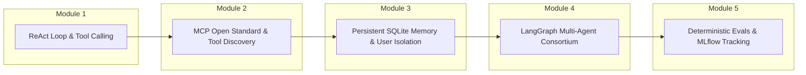

# Agentic AI Hands-on Lab

Welcome to the **Agentic AI Hands-on Laboratory**, designed for the MSc course *AI In Practice (2026)* at BME. This curriculum teaches you how to build, understand, evaluate, and debug modern Agentic AI systems from first principles.

---

## 🎯 Course Objective & Central Theme

Traditional LLM applications rely on single-turn completions or rigid pipelines. In contrast, **Agentic AI** equips foundation models with agency: the autonomy to reason, plan, invoke external tools, retain state across sessions, collaborate in multi-agent hierarchies, and recover from runtime failures.

Throughout this course, you will build a production-grade **University Research Assistant**. Over five progressive hands-on modules, your assistant will evolve from a basic calculator-equipped reasoning loop into a distributed, multi-specialist research consortium:



---

## 📚 Curriculum Roadmap

| Module | Topic | Core Technologies | Key Concepts Learned |
| :--- | :--- | :--- | :--- |
| [**Lab 1**](01-tool-calling.md) | **Tool Calling & ReAct** | OpenAI SDK, JSON Schema | Thought-Action-Observation loop, function schemas, AST safe math, execution containment |
| [**Lab 2**](02-mcp.md) | **Model Context Protocol (MCP)** | Anthropic MCP Standard, JSON-RPC 2.0 | Client-Server tool exposure, dynamic capability discovery, stdio & in-memory transports |
| [**Lab 3**](03-memory.md) | **Agent Memory & Personalization** | SQLite, Dynamic Context Injection | Short-term conversation history, user isolation, long-term preferences, memory self-tools |
| [**Lab 4**](04-multi-agent.md) | **Multi-Agent Systems & LangGraph** | LangGraph StateGraph, Specialized Prompts | Supervisor-Specialist hierarchy, conditional routing, cyclic delegation detection, shared state |
| [**Lab 5**](05-evaluation.md) | **Agent Evaluation & MLflow** | MLflow, Deterministic Evals, Pandas | Multi-agent benchmarking, Precision/Recall/F1 for tools, latency/token efficiency, MLflow tracking |
| [**Failure Museum**](failure-museum.md) | **Agent Failure Museum** | Guardrails, Cycle Detection, Error Handling | 6 reproducible failure scenarios with regression tests: infinite loops, hallucinations, bad args, MCP drops, leaks, ping-pong |

---

## 🛠️ Technology Stack & Architecture Principles

To ensure lasting foundational knowledge, this lab is built on modern industry standards rather than heavy monolithic frameworks:

1. **OpenAI Python SDK (`openai>=1.12.0`)**: Standardized interface for model inference. Seamlessly works with OpenAI models, local **Ollama** instances, and self-hosted **vLLM** endpoints.
2. **Anthropic Model Context Protocol (MCP)**: The emerging open standard for decoupling external services, databases, and APIs from agent implementations via JSON-RPC 2.0.
3. **Pure SQLite Storage Engine**: Deterministic relational persistence with foreign keys, compound indexes, and ACID guarantees—ensuring strict per-student privacy and isolation.
4. **LangGraph StateGraph**: Graph-based state machine orchestration with cyclical detection, checkpointing, and modular conditional transitions.
5. **MLflow (`mlflow>=2.10.0`)**: Rigorous experiment tracking and metric visualization for LLM applications.

> [!NOTE]
> **Deterministic Mock LLM Included**: All labs and tests ship with a built-in deterministic `MockLLMClient`. You can complete the entire curriculum and pass 100% of unit tests without needing an external API key or GPU, while still retaining full capability to switch to live OpenAI or Ollama models with a single environment variable change!

---

## 🚀 Environment Setup

### 1. Prerequisites
- Python **3.11** or higher
- Git

### 2. Clone Repository & Setup Virtual Environment
```bash
# Clone the repository
git clone https://github.com/czotterbenedek/Agentic-AI-hands-on-lab.git
cd agentic-ai-hands-on-lab

# Create and activate a virtual environment
python3 -m venv venv
source venv/bin/activate  # On Windows: venv\Scripts\activate

# Install required dependencies
pip install -r requirements.txt
```

### 3. Configure Environment Variables
Copy the template configuration:
```bash
cp .env.example .env
```

Open `.env` in your editor. By default, `LLM_PROVIDER=mock` is enabled. If you have an OpenAI API key or local Ollama instance:
```ini
# To use live OpenAI:
LLM_PROVIDER=openai
OPENAI_API_KEY=sk-...
LLM_MODEL=gpt-4o-mini

# Or to use local Ollama:
LLM_PROVIDER=ollama
OLLAMA_BASE_URL=http://localhost:11434/v1
LLM_MODEL=llama3.1
```

---

## 📂 Repository Structure

The project is structured into clear, mirror-matched directories:

```text
agentic-ai-hands-on-lab/
├── docs/                      # Lab guides, documentation, and Failure Museum (MkDocs)
│   ├── index.md
│   ├── 01-tool-calling.md
│   ├── 02-mcp.md
│   ├── 03-memory.md
│   ├── 04-multi-agent.md
│   ├── 05-evaluation.md
│   └── failure-museum.md
├── labs/                      # Starter code for students (contains guided # TODO tags)
│   ├── 01-tool-calling/
│   ├── 02-mcp/
│   ├── 03-memory/
│   ├── 04-multi-agent/
│   └── 05-evaluation/
├── solutions/                 # Complete, runnable reference solutions
│   ├── 01-tool-calling/
│   ├── 02-mcp/
│   ├── 03-memory/
│   ├── 04-multi-agent/
│   └── 05-evaluation/
├── shared/                    # Reusable agent, LLM client, config, and logging utils
│   ├── llm_client.py
│   ├── agent.py
│   ├── config.py
│   └── logging.py
├── mcp_server/                # Standalone entrypoint shim for Research MCP Server
├── memory/                    # Standalone entrypoint shim for SQLite Memory Storage
├── multi_agent/               # Standalone entrypoint shim for Multi-Agent Supervisor
├── evaluation/                # Standalone entrypoint shim for Benchmark Evaluator
├── tests/                     # Unit test suites & Failure Museum regression tests
├── requirements.txt           # Python package requirements
└── mkdocs.yml                 # Documentation site configuration
```

---

## 🧑‍💻 How to Work Through the Labs

1. **Read the Module Guide**: Before touching code, read the respective lab documentation page (e.g. `Lab 1: Tool Calling & ReAct`).
2. **Find the TODOs**: Open the starter lab directory in `labs/<module-number>/`. Search for `# TODO [Lab X.Y]` tags.
3. **Understand Scaffolding vs Implementation**:
   - The infrastructure, schema generation, network dispatchers, and logging are already provided so you don't waste time on boilerplate.
   - Your job is to implement the core agentic logic: safety parsing, tool dispatching, protocol handling, context injection, LangGraph nodes, and metric aggregations.
4. **Test Your Work**:
   ```bash
   # Run the interactive lab script
   python3 labs/01-tool-calling/run_lab.py

   # Run the unit tests for your starter lab
   python3 -m pytest labs/01-tool-calling/test_lab.py
   ```
5. **Verify Against Reference Solutions**:
   Reference implementations exist in `solutions/`. If you get stuck, study the patterns used there, but ensure you write and comprehend your own code in `labs/`.

Let's begin with **[Lab 1: Tool Calling & ReAct](01-tool-calling.md)**!
